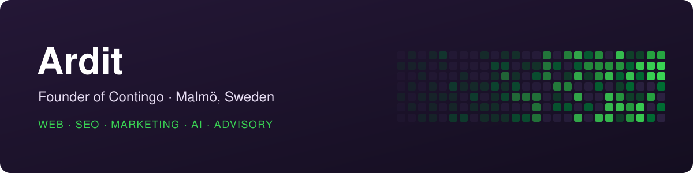

  

Hi, I'm Ardit. I run [Contingo](https://contingo.se), a digital agency in Malmö, Sweden. We build websites and help companies with SEO, marketing and AI, from the first plan to launch day and well after it.

Most of my building now happens together with Claude Code. I like fast sites and plain words, and I build things so the work is easy to pick up again next week.

### What I work on

- **Websites** in Astro and WordPress, checked for speed and accessibility before they go live
- **SEO and marketing** that start from the site itself, with content people search for and numbers you can trust
- **AI in real work**: Claude in client projects, and advice for teams who want to use it well

### Open source

**[Session Guardian](https://github.com/A-rdit/session-guardian)** 
Keeps long Claude Code sessions cheap and easy to pick up. A countdown before a session's cache goes cold, wrap-up nudges, `/wrapup`, a guard against retry loops, and session ID and tracker rules for CLAUDE.md.

**[Claude Code good practices](https://github.com/A-rdit/session-guardian/blob/main/docs/claude-code-good-practices.pdf)** (PDF, two pages) 
How Claude Code spends your usage limit, and ten habits that make your plan last longer. Free to share.

### Get in touch

Want to work with Contingo? Start at **[contingo.se](https://contingo.se)**.
